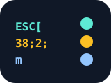

<div align="center">




[](LICENSE)
[](https://github.com/CyberLoop-dev/ansi-palette-lab)
[](https://github.com/CyberLoop-dev/ansi-palette-lab/stargazers)
[](https://github.com/CyberLoop-dev/ansi-palette-lab/commits/main)

**Build terminal color sequences with confidence.**

</div>

## 🧭 Overview

ansi palette lab is a small, local-first tool for developers. Build terminal color sequences with confidence. It keeps the workflow focused and does not require an account or a hosted service.

## ✨ Features

- ✨ Preview foreground and background colors in a terminal-style panel.
- ✨ Generate 16-color, 256-color, and 24-bit truecolor escape sequences.
- ✨ Copy a reset-safe snippet for shell scripts and terminal output.
- ✨ Run locally with Node.js built-ins only.

## 🎬 Demo

Start the local server, choose a mode and colors, then copy the generated ANSI snippet. The preview updates as you edit the controls.

## 🚀 Quick Start

```bash
npm start
```

Then open the local address printed by the server, or follow the CLI output.

## 🧰 Tech Stack

- 🟢 Node.js and browser-native HTML, CSS, and JavaScript
- 🧱 Small, readable source files
- 🔒 Local processing; no telemetry or account required

## 🗂️ Folder Structure

```text
ansi-palette-lab/
├── public/
│   ├── index.html
│   ├── styles.css
│   └── app.js
├── assets/icon.svg
├── server.js
├── package.json
└── README.md
```

## 🗺️ Roadmap

- [ ] 🧪 Add focused automated tests
- [ ] 🧩 Add more presets based on user feedback
- [ ] 📦 Publish a versioned release

## 🤝 Contributing

Issues and pull requests are welcome. Keep changes small, document behavior, and include a reproducible example when reporting a bug.

## 📄 License

Released under the [MIT License](LICENSE).

<div align="center">

</div>
